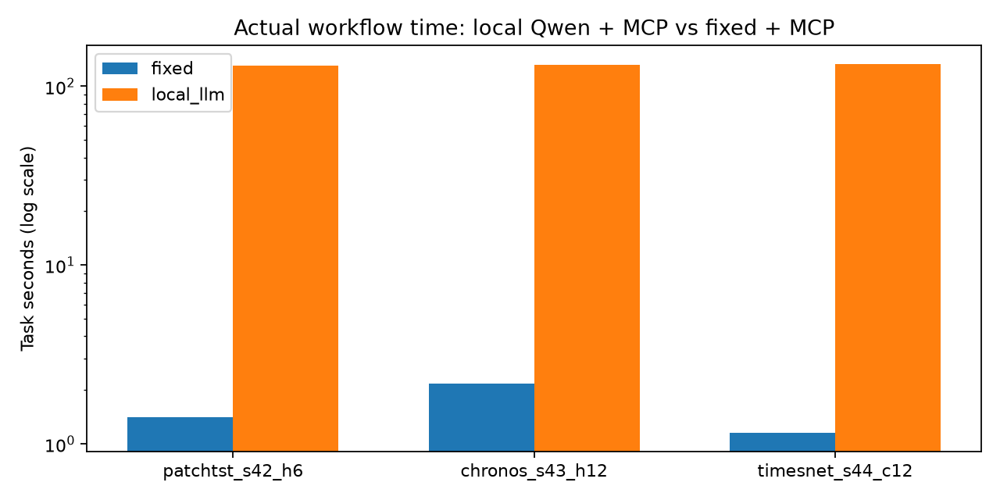

# 真实本地 LLM + MCP 实验

运行时间：2026-10-15T13:54:14.849014+00:00。模型：`Qwen/Qwen3-0.6B`，固定 revision `c1899de289a04d12100db370d81485cdf75e47ca`。

真实模型推理，真实 arXiv API，真实 stdio MCP 子进程，真实 Python 实验；未使用模拟 LLM 输出。
本次执行和代码由 AI 助手完成；代码与产物公开供维护者独立复跑和核验。

## 预先固定的协议

- 3 个任务在运行前定义于 benchmarks/tasks.json，所有任务和失败均保留，无成功筛选。
- 对照：固定六步工作流 + MCP；实验组：Qwen 根据工具 schema 生成调用 + MCP。两者均联网检索。
- 系统提示已规定工具顺序；这是受约束的工具调度，不是开放式自主科研规划。
- 每任务最多 12 轮，每轮最多 192 新 token；greedy，关闭 thinking，CPU float32，2 个线程。
- 任务成功需同时满足：生成报告、配置严格匹配、非空实时论文证据，以及独立重算指标一致。
- 方法证据仍是摘要原文保留，不包含全文理解；实验是合成周期信号 Ridge AR，并非论文模型复现。
- Prompt token 为每轮完整输入 token 数之和；本地推理无 API token 账单。耗时含推理/网络/工具，不含模型首次下载与加载。

## 工作流结果

| 任务 | 调度方式 | 成功 | 模型轮数 | 工具成功/尝试 | 参数匹配 | 秒数 |
|---|---|---|---:|---:|---|---:|
| patchtst_s42_h6 | fixed | True | 0 | 6/6 | True | 1.41 |
| patchtst_s42_h6 | local_llm | True | 7 | 6/7 | True | 131.03 |
| chronos_s43_h12 | fixed | True | 0 | 6/6 | True | 2.17 |
| chronos_s43_h12 | local_llm | True | 7 | 6/7 | True | 131.57 |
| timesnet_s44_c12 | fixed | True | 0 | 6/6 | True | 1.16 |
| timesnet_s44_c12 | local_llm | True | 7 | 6/7 | True | 133.54 |

## 聚合结果

- fixed: 成功 3/3，工具失败 0/18，模型解析失败 0，总 token 0，总任务时间 4.73 秒。
- local_llm: 成功 3/3，工具失败 3/21，模型解析失败 0，总 token 43602，总任务时间 396.15 秒。

## Python 实验指标

指标为训练集标准差归一化后的合成信号误差，不用于证明 Agent 的研究质量；应与工作流完成率分别理解。

| 任务 | 调度 | Persistence Test MSE | Ridge AR Test MSE | Ridge AR Test MAE |
|---|---|---:|---:|---:|
| patchtst_s42_h6 | fixed | 0.426927 | 0.014485 | 0.097750 |
| patchtst_s42_h6 | local_llm | 0.426927 | 0.014485 | 0.097750 |
| chronos_s43_h12 | fixed | 0.932137 | 0.014311 | 0.096050 |
| chronos_s43_h12 | local_llm | 0.932137 | 0.014311 | 0.096050 |
| timesnet_s44_c12 | fixed | 0.412801 | 0.065746 | 0.209977 |
| timesnet_s44_c12 | local_llm | 0.412801 | 0.065746 | 0.209977 |

## 失败与边界

- 这 3 个任务没有观察到任务失败；不能外推为通用 Agent 成功率 100%。
- 网络时延和固定执行顺序会影响耗时对比；样本量仅 3，未随机化执行顺序，无统计显著性结论。
- 控制组显式给定配置，LLM 组需从提示提取配置；对照主要检查额外模型调用的成本与参数遵循。
- 未测试长任务、PDF 方法理解、任意代码生成、工具发现泛化、提示注入鲁棒性或真实科研效率提升。
- 论文内容不是实验代码来源；相同配置下两个调度器应得到相同数值，不能将低预测误差归因于 LLM。

## 产物与复跑

- 每个任务/调度目录：run.json、model-trace.json、tool-attempts.json、mcp-protocol.json、trace.json；完成实验时另存 metrics.json/report.md。
- benchmark.json 包含版本、模型 commit、代码 commit、预定义任务与所有聚合原始记录；环境见 environment.txt。

```bash
pip install torch --index-url https://download.pytorch.org/whl/cpu
pip install -e '.[local]'
python -m research_agent.benchmark --out runs/local-mcp-replay
```

## 原始记录复核与工具错误

- patchtst_s42_h6 / local_llm，工具尝试 5：`experiment_summary` → `ValueError: KeyError: 'evaluation'`；后续最终完成任务。详见其 model-trace.json 与 MCP 原始响应。
- chronos_s43_h12 / local_llm，工具尝试 5：`experiment_summary` → `ValueError: KeyError: 'evaluation'`；后续最终完成任务。详见其 model-trace.json 与 MCP 原始响应。
- timesnet_s44_c12 / local_llm，工具尝试 5：`experiment_summary` → `ValueError: KeyError: 'evaluation'`；后续最终完成任务。详见其 model-trace.json 与 MCP 原始响应。
- patchtst_s42_h6：两个调度器的全部数值实验结果完全一致。改进点是工具调用能力，不是预测模型性能。
- chronos_s43_h12：两个调度器的全部数值实验结果完全一致。改进点是工具调用能力，不是预测模型性能。
- timesnet_s44_c12：两个调度器的全部数值实验结果完全一致。改进点是工具调用能力，不是预测模型性能。
- 任务通过标准只要求非空的实时论文证据，尚未评价检索相关性或是否精确命中原论文。关键词结果含引用该模型的后续论文，不能称作精确论文定位。
- 首次启动在模型元数据初始化处失败，尚未执行任何任务；setup-failure/ 中保留该错误和日志。修复 Transformers 版本兼容后，保持任务与提示不变执行完整实验。


